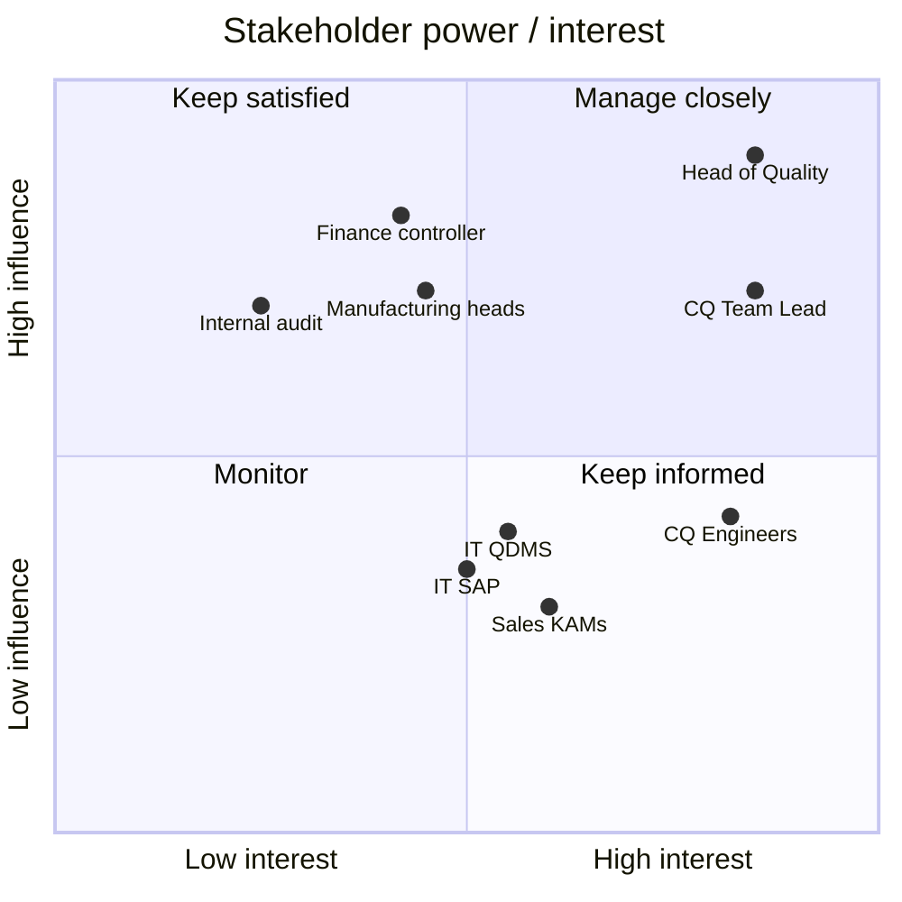

# 02 · Stakeholder Analysis

## Stakeholder register

| Stakeholder | Role in project | Interest | Influence | Key concerns | Engagement approach |
|---|---|---|---|---|---|
| Head of Quality | Sponsor, approves scope and benefits | High | High | OEM supplier scorecards, audit readiness | Monthly steering, one-page status |
| Customer Quality Team Lead | Process owner, BA, UAT lead | High | High | Team workload, response targets | Owns requirements and UAT |
| Customer Quality Engineers (6) | Primary users | High | Medium | Less re-keying, fewer chasers, usable screens | Workshops, process walk-throughs, UAT testers |
| Manufacturing department heads | Own root cause and corrective actions | Medium | High | Clear ownership, not more admin | Ownership model agreed in workshop, overdue alerts |
| IT – QDMS configurator | Builds workflow, fields, picklists | Medium | Medium | Clear, testable requirements | Weekly backlog review |
| IT – SAP integration developer | Builds master-data look-ups and hand-off file | Medium | Medium | Stable interface spec, SAP load | Data requirements spec, test data |
| Finance controller | Approves credit notes > €2,000, owns SAP posting | Medium | High | Control, audit trail, no posting errors | Approval-rule workshop, sign-off on FR-10–12 |
| Sales / Key Account Managers | Customer contact | Medium | Medium | Customer satisfaction, visibility of status | Briefing, read access to case status |
| Internal audit / QMS coordinator | IATF 16949 compliance | Low | High | Record retention, approval evidence | Review of NFRs and audit-trail tests |
| Key OEM customers | Receive responses and 8D reports | High | High (indirect) | Speed and quality of responses | No direct involvement; measured via SLA |

## Power / interest grid

## RACI

R = Responsible, A = Accountable, C = Consulted, I = Informed

| Deliverable | Head of Quality | CQ Team Lead (BA) | CQ Engineers | Manufacturing | IT QDMS | IT SAP | Finance | Audit |
|---|---|---|---|---|---|---|---|---|
| Project brief & KPIs | A | R | C | C | I | I | C | I |
| As-is / to-be process maps | I | A/R | C | C | C | I | C | I |
| Business requirements (BRD) | A | R | C | C | C | C | C | C |
| Data requirements (SAP fields) | I | A | C | I | C | R | C | I |
| QDMS configuration | I | A | I | I | R | C | I | I |
| Credit-note approval rules | C | R | I | I | C | I | A | C |
| UAT execution & sign-off | A | R | R | I | C | C | C | I |
| Training & rollout | I | A/R | C | I | C | I | I | I |
| Benefits tracking | A | R | I | I | I | I | C | I |
