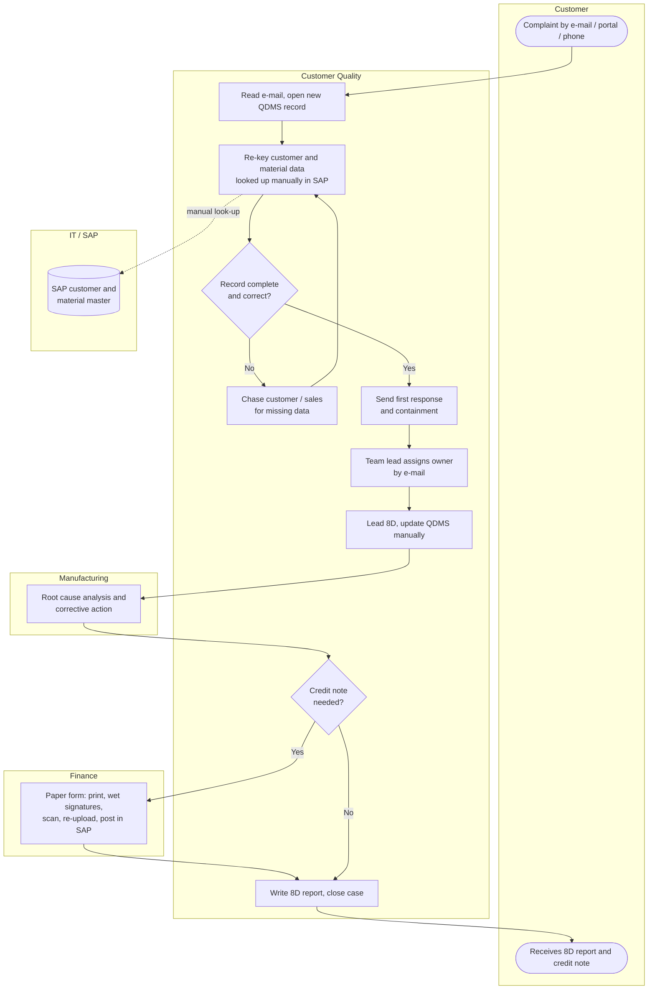

# 03 · As-Is Process

Mapped from three walk-through sessions with the Customer Quality team, a review of 40 closed 2024 cases in QDMS, and the 2024 complaint event log (see [data](../data/complaint_event_log.csv)).

## Swimlane map

## Step analysis

| # | Step | Who | Typical issue observed | Waste type |
|---|---|---|---|---|
| 1 | Complaint received | Customer → CQ inbox | E-mails sit in a shared inbox until an engineer is free | Waiting |
| 2 | Registration in QDMS | CQ engineer | Customer and material data re-keyed from e-mail and SAP; free-text defect description | Over-processing, defects |
| 3 | Completeness check | CQ engineer | No mandatory fields; missing batch or customer reference found later | Defects, rework |
| 4 | First response | CQ engineer | Not started until the record is "clean"; no timer or reminder | Waiting |
| 5 | Assignment | Team lead | Ownership decided case by case by e-mail; depends on lead's availability | Waiting, motion |
| 6 | Root cause & corrective action | Manufacturing | Status updates held in e-mails, not QDMS; actions go overdue silently | Waiting |
| 7 | Credit-note approval | CQ → Finance | Printed form travels for two signatures, then scanned and re-uploaded | Transport, motion, waiting |
| 8 | Weekly reporting | Team lead | KPIs compiled by hand from QDMS exports into Excel (≈3 h/week) | Over-processing |

## Pain points (from workshops)

1. "I type the same customer and part data that is already in SAP." — CQ engineer
2. Missing batch numbers and customer references surface days later, so the record goes back to the engineer and the clock keeps running.
3. Nobody is alerted when a first response is about to miss the customer's 1.5-day expectation.
4. Credit notes wait for signatures when approvers are off-site; Finance receives scans with missing fields.
5. The weekly CEO report takes hours to compile and figures differ depending on who builds it.

## Root cause analysis

### 5 Whys — "Why is first response slower than 1.5 days?"

1. **Why?** The first response is only sent after the record is registered and checked.
2. **Why is registration slow?** Engineers re-key customer and material data and look it up in SAP by hand.
3. **Why is the record often incomplete?** QDMS has no mandatory fields or validation against SAP, so gaps are found later.
4. **Why is that not caught earlier?** Completeness is checked by people, not by the system, and there is no SLA timer to prompt action.
5. **Why?** QDMS was configured as a document store, not as a workflow linked to SAP master data. → **Root cause: no system integration or enforced data standard at the point of intake.**

### Fishbone (cause categories)

| Category | Causes |
|---|---|
| Method | No standard intake form; ownership decided case by case; paper approval route |
| System | QDMS not linked to SAP master data; no mandatory fields; no SLA timers |
| People | Workload peaks; knowledge of SAP look-ups varies across engineers |
| Data | Free-text defect descriptions; batch / customer reference missing in source e-mails |
| Measurement | KPIs compiled manually and weekly, so delays are seen too late to act |
| Environment | Approvers often on the shop floor or off-site, away from paper forms |

## Measured baseline

Baseline KPIs and the largest waits in the as-is flow are generated from the 2024 event log — see the [project brief](01_project_brief.md#baseline-as-is-2024) and [`outputs/step_waiting_times.csv`](../outputs/step_waiting_times.csv).
