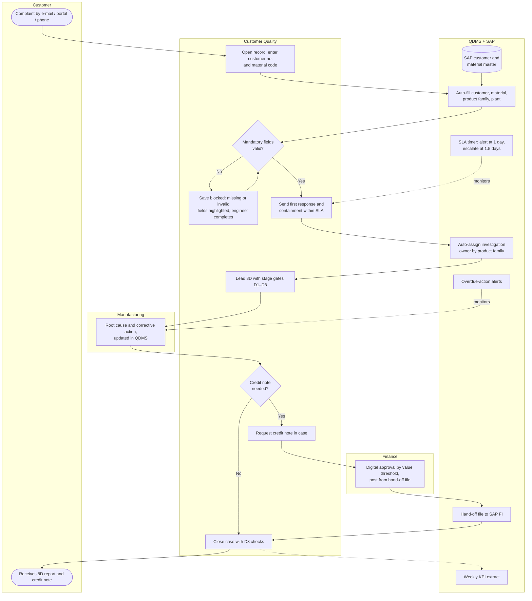

# 04 · To-Be Process

Design principle: **capture data once, at the source, and let the system move the case** — the engineer's time goes to investigation, not administration.

## Swimlane map

## What changes and why

| Change | Replaces | Why | Requirement |
|---|---|---|---|
| SAP look-up auto-fills customer and material data | Manual re-keying | Removes the biggest manual step and the main source of errors | FR-01, FR-02 |
| Mandatory fields + defect-code picklist | Free text, optional fields | Complete, analysable records first time; enables Pareto by defect | FR-03, FR-04 |
| Duplicate check on customer reference | Duplicates found later | Avoids parallel investigations of the same complaint | FR-05 |
| Auto-assignment by product family | Team lead assigns by e-mail | Removes waiting on one person; builds department ownership | FR-06 |
| SLA timer and escalation | No reminders | Makes the 1.5-day expectation visible before it is missed | FR-07 |
| 8D stage gates and overdue alerts | Status in e-mails | Status lives in one place; actions do not go overdue silently | FR-08, FR-09 |
| Digital credit-note approval with value thresholds | Printed form, wet signatures, scans | Removes transport and waiting; keeps an auditable trail | FR-10, FR-11 |
| Hand-off file to SAP FI | Finance re-keys from scans | No change to SAP posting logic (constraint) while removing re-keying | FR-12 |
| Weekly KPI extract | Manual Excel compilation | One version of the numbers; saves ≈3 h/week | FR-13 |

## Gap analysis

| Area | As-is | To-be | Gap / change required | Type |
|---|---|---|---|---|
| Intake data | Re-keyed, free text | SAP-sourced, validated | Read-only SAP look-up service; QDMS field mapping | System (integration) |
| Data standard | No mandatory fields | Six mandatory fields, picklist | QDMS configuration; agreed defect catalogue | System + process |
| Ownership | Case-by-case | Product-family ownership matrix | Ownership matrix agreed with Manufacturing heads | Process / people |
| Response control | None | SLA timer + escalation | Workflow rule and e-mail templates | System |
| Investigation tracking | E-mail | 8D stage gates in QDMS | Stage fields, gate rules, training | System + people |
| Credit notes | Paper, two signatures | Digital, threshold-based | Approval matrix (Finance sign-off), workflow, audit trail | System + policy |
| Finance hand-off | Scans re-keyed | Structured CSV hand-off | File spec agreed with Finance and SAP team | System |
| Reporting | Manual Excel | Scheduled KPI extract | KPI definitions document; extract job | System + data |
| Skills | Varies by engineer | Standard work instruction | Training, quick-reference guide | People |
